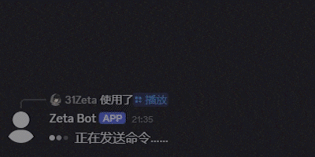
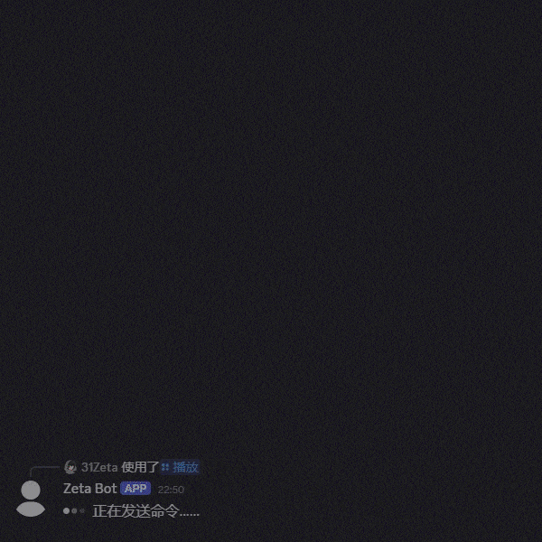
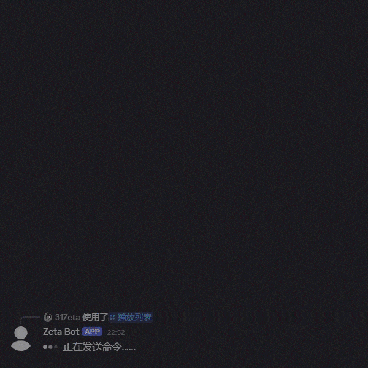

# Zeta Discord 机器人
中文 | [English](docs/README_en.md)  

一个基于Pycord的Discord机器人  
作者目前业余编程，如有不规范的地方请多多包涵与指教  

目前机器人只有中文可用  

目录 Table of contents
------------------------
- [核心功能](#核心功能)
- [运行](#运行)
- [Web 控制面板与监控](#web-控制面板与监控)
- [网易云音乐与QQ音乐](#网易云音乐与qq音乐)
- [（可选）使用 go-music-api](#可选使用-go-music-api)

## 核心功能
- 在Discord音频频道中播放来自哔哩哔哩、YouTube、网易云音乐、QQ音乐的音频（内置接口，无需部署额外服务）
- 在Discord音频频道中播放来自YouTube的音频
- 直接在Discord频道内进行哔哩哔哩或YouTube搜索并播放
- 可交互的播放列表（顺序/单曲循环/列表循环/随机播放，上一首，播放进度）
- Web 控制面板与监控面板：实时运行状态、播放控制、搜索、音频库、收藏夹与日志






## 运行
**请使用Python 3.10-3.13版本**

### 源码下载与依赖安装
请从 **[release](https://github.com/31Zeta/Zeta-DiscordBot/releases)** 中下载最新版本源码解压
  
在解压后的源码根目录下使用以下指令来安装依赖包：  
```
 pip install -r requirements.txt
```

Linux系统还需要安装：  
```
sudo apt install libopus0
```


### 安装或链接 FFmpeg
Windows系统请前往 [FFmpeg官网](https://ffmpeg.org/download.html) 获取ffmpeg.exe 或 [直接下载](https://www.gyan.dev/ffmpeg/builds/ffmpeg-git-full.7z) 后解压bin文件夹内的ffmpeg.exe  
  
Linux系统可使用bin文件夹内自带的ffmpeg或前往 [FFmpeg官网](https://ffmpeg.org/download.html) 获取最新版ffmpeg  

将解压出的ffmpeg文件放入库中的bin文件夹内

### 启动
输入以下命令以运行机器人：  
```
python main.py
```

根据提示完成设置，保持窗口打开以确保机器人正常运行  
考虑使用守护进程避免机器人意外关闭  

### 修改设置
如需修改设置，则使用以下命令启动机器人（0.7.0及更高版本）：
```
python main.py --mode=setting
```  

### [额外] yt-dlp 配置
如果需要使用机器人的YouTube相关功能推荐为`yt-dlp-ejs`启用JavaScript运行环境。
`yt-dlp-ejs`已经包含在了`requirements.txt`的`yt-dlp[default]`中，会在安装依赖包时自动安装。环境的选择与安装可以参考此页面：[Step 1: Install a supported JavaScript Runtime](https://github.com/yt-dlp/yt-dlp/wiki/EJS#step-1-install-a-supported-javascript-runtime)  

首次启动后会生成 `configs/ytdlp_config.json`：
| 选项 | 说明 |
| --- | --- |
| `cookie_file` | Netscape 格式的 Cookie 文件（默认 `./configs/cookies.txt`），YouTube 提示“登录以确认您不是机器人”时使用 |
| `js_runtime` | JavaScript 运行时，`auto` 会依次检测 deno、node、bun；也可指定 `node` 等，`none` 为禁用 |
| `proxy` | 代理地址，例如 `http://127.0.0.1:7890`，留空为不使用 |


## Web 控制面板与监控
机器人启动后会同时启动 Web 控制面板（默认 `http://localhost:5000`），包含：
- **监控**：Discord 连接与延迟、运行时间、各服务器播放状态、系统资源（CPU/内存/磁盘，需要 `psutil`）、音频库缓存、音源状态（网易云/QQ音乐登录状态、yt-dlp、FFmpeg）、下载任务、指令统计与延迟趋势图
- **播放**：加入/离开语音频道、播放/暂停/上一首/下一首、拖动进度条、音量、播放模式、拖动排序队列、播放历史
- **搜索 / 音频库 / 收藏夹**：搜索并加入队列、将已缓存的音频直接加入队列或下载、收藏夹
- **日志**（仅管理员）：实时滚动的运行日志

页面通过 Server-Sent Events 实时更新，Discord 中的操作会立即同步到网页。

**登录**：在 Discord 中使用 `/webauth`（`/网页控制面板`）获取一次性验证码（10 分钟内有效），登录状态保持天数可通过指令参数设置（默认 3 天）。网页中的权限与 Discord 指令权限一致，普通用户只能看到自己所在的服务器。

**端口与挂载**：首次启动后会生成 `configs/web_config.json`：
| 选项 | 说明 |
| --- | --- |
| `enabled` | 是否启用 |
| `host` | 监听地址，`0.0.0.0` 为所有网卡，`127.0.0.1` 为仅本机 |
| `port` | 监听端口，默认 `5000` |
| `base_path` | URL 前缀，使用反向代理挂载到子路径时设置，例如 `/zeta` |
| `public_url` | `/webauth` 回复中显示的面板地址（使用域名或反向代理时设置） |
| `api_token` | 只读 API 令牌，供外部监控工具使用（请求头 `Authorization: Bearer <令牌>`，仅允许 GET） |

也可以使用启动参数或环境变量覆盖：
```
python main.py --web-port 8090 --web-host 127.0.0.1 --web-base-path /zeta
python main.py --no-web
```
环境变量：`ZETA_WEB_PORT`、`ZETA_WEB_HOST`。健康检查接口 `/healthz` 无需登录，可用于 Uptime Kuma 等监控工具。

使用 Nginx 反向代理时，请为实时推送关闭缓冲：
```
location /zeta/ {
    proxy_pass http://127.0.0.1:5000;
    proxy_buffering off;
    proxy_read_timeout 1h;
}
```
**注意**：面板没有内置 HTTPS，暴露到公网时请使用反向代理配置 HTTPS。

## 网易云音乐与QQ音乐
机器人内置了网易云音乐与QQ音乐的接口（`zeta_bot/native_music`），直接向平台请求，**不需要部署 go-music-api 等外部服务**。支持单曲、歌单、专辑链接（包括分享短链），`/search_audio` 也可以搜索这两个平台。

**登录（播放会员歌曲）**
**注意：配置登录信息后，无论对机器人发出指令的用户是谁，所有下载都会使用该账号进行请求，请自行斟酌并承担可能带来的账户风险**
- 网易云音乐：运行 `python music_login.py netease`，使用网易云音乐App扫描终端中的二维码，Cookie会保存在 `data/cookies/netease.json`
- QQ音乐：在浏览器中登录 https://y.qq.com ，使用 Cookie 导出插件（例如 Cookie-Editor）导出JSON格式的 Cookie，粘贴到 `data/cookies/qq.json`（运行 `python music_login.py qq` 查看说明）
- 修改登录信息后需要重启机器人

**地区限制**：两个平台的大部分歌曲只能在中国大陆播放（与是否登录无关），在其他地区运行机器人时会提示"该歌曲在当前地区不可播放"，可以在 `configs/music_config.json` 中设置代理。

首次启动后会生成 `configs/music_config.json`：
| 选项 | 说明 |
| --- | --- |
| `proxy` | 访问网易云音乐与QQ音乐使用的代理（HTTP代理），例如 `http://127.0.0.1:7890`，留空为不使用 |
| `netease_level` | 网易云音乐音质：`standard` / `higher` / `exhigh`（默认）/ `lossless` / `hires`，高音质需要会员 |
| `qq_quality` | QQ音乐音质：`320`（默认）/ `128` / `aac`，无法获取时自动降级 |

## （可选）使用 go-music-api
如果更希望使用 [go-music-api](https://github.com/guohuiyuan/go-music-api) 作为下载后端，可以在部署后修改 `configs/resource_handler.json`，将对应平台的值改为 `GO_MUSIC_API`（可选值：`NATIVE` 内置接口、`GO_MUSIC_API`、`BILIBILI_API_PYTHON`、`YT_DLP`），并在设置中填写 go-music-api 的地址。go-music-api 不可用时会自动改用内置接口。

为 go-music-api 配置 Cookie：
- 直接为 go-music-api 服务配置 Cookie，参考 [Cookie配置](https://github.com/guohuiyuan/go-music-api#cookie-配置)
- 或将浏览器导出的 Cookie 放在 `data/cookies/对应平台.json`，机器人会将其同步到 go-music-api
- 或使用 `python go_music_qr_login.py` 通过 go-music-api 扫码登录
